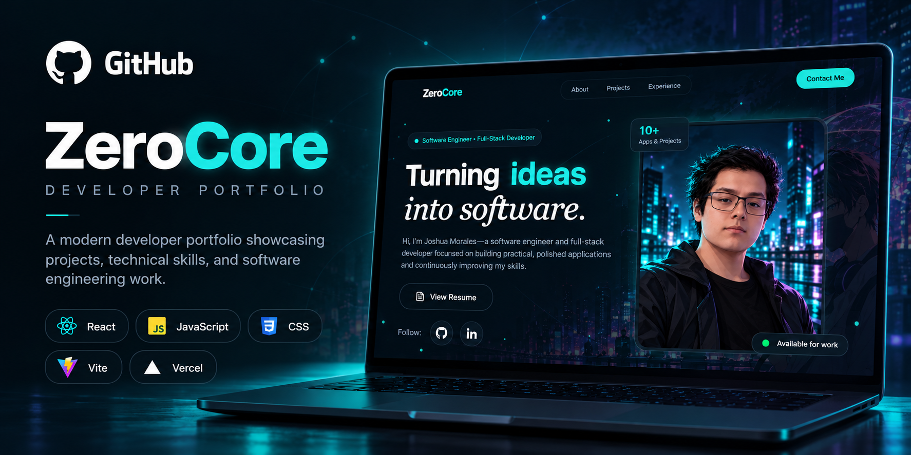

# 🌐 ZeroCore

### Joshua Morales — Developer Portfolio

My personal portfolio website: one place to explore my software projects and learn more about the work I build.

**Status:** Live website · **Source code:** Private · **Hosting:** Vercel

---

## ✨ Overview

**ZeroCore** is my personal developer portfolio. It serves as a central hub for my software development work, making it easy to visit my projects and connect with me.

## 🎯 Purpose

- Give visitors a clear introduction to my developer work.
- Bring my projects together under one personal website.
- Make it easy to explore live applications and connect on GitHub or LinkedIn.
- Maintain a portfolio I can update as I build more projects.

## 🚀 Projects to Explore

| Project | Description | Link |
| --- | --- | --- |
| **ZeroRadar** | Price tracking with price history and email alerts. | [Live application](https://zeroradar.me) |
| **StellarQuant** | MERN application with authentication and a simulated strategy dashboard. | [Live demo](https://zeropeak.me) |
| **DevShare** | Developer-focused link-sharing platform, currently in development. | Coming soon |

## 🛠️ Deployment

ZeroCore is deployed on **Vercel**, with its source code maintained in a private GitHub repository.

## 🖼️ Preview

Add a screenshot of the portfolio homepage here.

<!--
1. Create an assets/ folder in this public showcase repository.
2. Upload a screenshot of your portfolio homepage.
3. Replace this comment with, for example:

-->
## 📸 Preview

## 🔗 Connect

- **Portfolio:** [zerocore.me](https://zerocore.me)
- **GitHub:** [JoshuaM-SWE](https://github.com/JoshuaM-SWE)
- **LinkedIn:** [Joshua Morales](https://www.linkedin.com/in/joshuamoralescsc/)

> **About this repository:** This repository documents the live ZeroCore portfolio. The website's application source code is not included.
